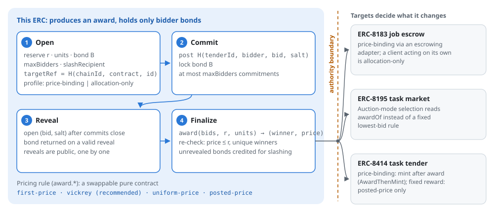
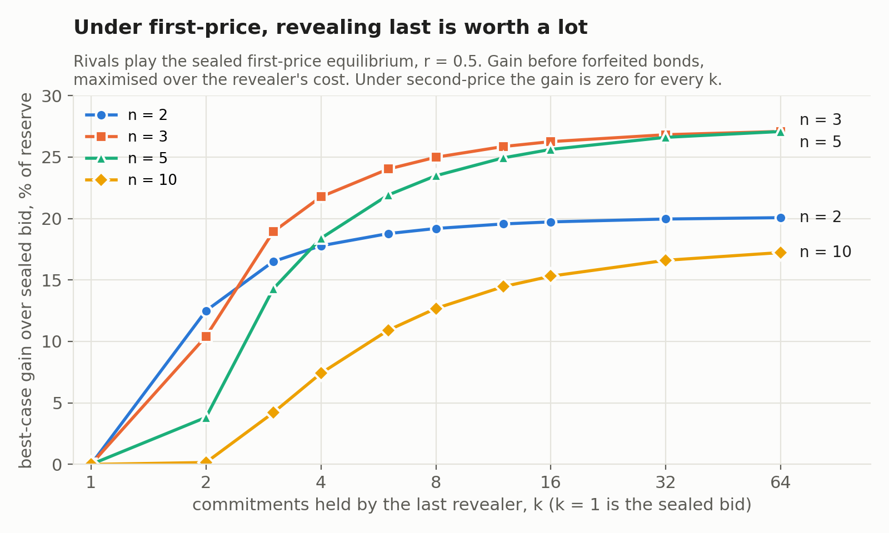

<div align="center">

# Sealed-Bid Award Mechanism for Task Tenders

**Who wins a task, and at what price — a draft ERC for agent task markets on Ethereum.**

[](https://github.com/shentonyan/sealed-bid-award-erc/actions/workflows/ci.yml)
[](https://github.com/ethereum/ERCs/pull/2114)
[](src/)
[](proofs/)
[](LICENSE.md)

[ERC submission](https://github.com/ethereum/ERCs/pull/2114) · [Draft mirror](erc/erc-draft_sealed_bid_award.md) ·
[Discussion](https://ethereum-magicians.org/t/sealed-bid-award-mechanism-for-task-tenders-companion-to-erc-8183-8195-8414/29814) ·
[Reference contracts](src/) ·
[Proof](proofs/) ·
[Analysis](analysis/) ·
[Paper](paper/sealed-bid-award-paper.pdf)

</div>

<br>

<picture>
  <source media="(prefers-color-scheme: dark)" srcset="docs/flow-dark.svg">
  
</picture>

Three task-escrow standards — [ERC-8183](https://eips.ethereum.org/EIPS/eip-8183),
[ERC-8195](https://ethereum-magicians.org/t/erc-8195-task-market-protocol/27935) and
[ERC-8414](https://ethereum-magicians.org/t/erc-8414-token-bound-task-tenders/29597) —
let an agent post a task, escrow the reward and pay on delivery. None of them says how to
choose among several agents who want the same task. This proposal fills only that gap: a
sealed-bid award that any of the three can consume, without holding task funds or acting on
the task.

> **Status.** Submitted to [ethereum/ERCs as PR #2114](https://github.com/ethereum/ERCs/pull/2114)
> with specification status `Draft`. An ERC number has not been assigned; this repository
> does not claim one. The submission is the proposed normative text, and `erc/` is its mirror.

## What it specifies

1. **A sealed-bid procedure.** Commit, reveal, finalize. A bond is returned on reveal and
   slashed if a commitment is never opened.
2. **A stateless mechanism interface.** `award(bids, reserve, units) → [(winner, price)]`,
   with seven conditions every rule must satisfy, including monotonicity and a fixed tie rule.
3. **Four normative pricing rules.** `award.first-price`, `award.vickrey` (recommended),
   `award.uniform-price` and `award.posted-price`, each a swappable pure contract.
4. **Two integration profiles.** Each tender declares, before anyone commits, what its award
   means to the target: *price-binding* (the target pays `Award.price` and executes every
   award) or *allocation-only* (the target pays a fixed amount, so the tender must use
   `award.posted-price`).
5. **One canonical target reference and an authority boundary.** An award names its target as
   `keccak256(abi.encode(chainId, targetContract, targetId))`, and confers no authority over it.

## Why second-price is the default

The interface separates allocation and payment, as in direct mechanisms in auction theory.
The single-unit second-price rule needs no beliefs about other bidders' private costs to
make truthful reporting weakly dominant under quasi-linear utilities, no collusion or
externalities, and the integration commitments below. Revenue equivalence has additional
equilibrium and boundary-utility assumptions; it does not make arbitrary plugins equivalent.

Running the auction on a public chain adds a reason specific to Ethereum. Reveals are public
and arrive one by one, so a bidder who reveals last can hold several commitments and open
only the best one. Under first-price that is worth a great deal. Under second-price it is
worth nothing, because truthful bidding is optimal whatever the others bid.

<picture>
  <source media="(prefers-color-scheme: dark)" srcset="analysis/fig2_ladder_dark.png">
  
</picture>

### When the truthfulness result applies

In the private-cost, quasi-linear model, truthful bidding is weakly dominant for the single-unit Vickrey allocation and payment rule. Whether it survives depends on
what the target does with the award. SergeevDmitry showed on the discussion thread that a
fixed reward breaks it ([post #5](https://ethereum-magicians.org/t/sealed-bid-award-mechanism-for-task-tenders-companion-to-erc-8183-8195-8414/29814/5)), and
chugarchugarr proposed separating price-binding from allocation-only integrations
([post #7](https://ethereum-magicians.org/t/sealed-bid-award-mechanism-for-task-tenders-companion-to-erc-8183-8195-8414/29814/7)). It holds only if the target

- **(a) is payment-binding:** it pays the winner `Award.price`, and
- **(b) is execution-binding:** once the award is final, anyone can trigger its execution, and
  no one, the requester included, can withhold it, pre-empt it or make it revert.

If the target pays a fixed reward instead, ranking by bid is not incentive compatible: with
reward 100, cost 60 and a rival bid of 50, bidding 40 wins and bidding the truth loses. The
only rule that stays incentive compatible under a fixed payment is a posted price, so
allocation-only tenders must use `award.posted-price`. If the requester can decline after
seeing the bids, (b) fails, which is why the price-binding ERC-8414 route below mints only
after the award, in one transition anyone can trigger, at a token id no one else can take.

The full numbers, including the value of the reserve and the effect of phantom commitments,
are in [`analysis/`](analysis/). The dominance property is proved for all inputs in
[`proofs/VickreyTruthful.lean`](proofs/VickreyTruthful.lean), and its limits in
[`proofs/IntegrationProfiles.lean`](proofs/IntegrationProfiles.lean).

## Task content and payment denomination

`contentHash` commits the work, payment denomination and acceptance policy at opening.
`bondAsset` is only the bond asset. The target or adapter publishes the descriptor encoding.
The native-asset `AwardThenMint` example computes
`keccak256(abi.encode(keccak256("sealed-bid.task.native.v1"), workHash, block.chainid, address(0), uint256(1), inner))`:
one integer unit is one native smallest unit, and `inner` identifies an immutable verifier
whose configuration is fixed by that deployment. `open` accepts `workHash`; `contentHashFor`
lets bidders reproduce the full descriptor hash. `settle` passes it to the task's mint
function and checks `taskHashOf` in the same transaction. Fulfillment checks the hash again.
The example mint and content-view surfaces are integration requirements, not ERC-8414 kernel
interfaces; the test token is a mock, not a conforming ERC-8414 implementation.

## What is checked, and where

Every push runs all three in [CI](.github/workflows/ci.yml).

| Check | What it covers |
| --- | --- |
| `npm test` | Golden vectors for all four rules; the seven `award` conditions over an exhaustive 3-bidder grid; Vickrey dominance and posted-price acceptance dominance by brute force; the fixed-reward counterexample; false-name bids (uniform-price is exploitable with two addresses, single-unit Vickrey is not); the full tender lifecycle, including integration-profile checks; both ERC-8414 adapters end to end |
| `forge test` | The same lifecycle in Foundry, fuzzed monotonicity and truthfulness, and regression tests for the bidder cap, rejecting slash recipients, USDT-style bond tokens and commit-order tie-breaking; faulty mechanisms (a winner who never revealed, a winner above the reserve, a price below the winner's bid) and a mechanism whose code is swapped after opening |
| `lean proofs/VickreyTruthful.lean` | Truthful bidding is weakly dominant under `award.vickrey`, for any reserve, any number of bidders in any commit order, and any deviation; no `sorry`, standard axioms only |
| `lean proofs/IntegrationProfiles.lean` | With a fixed reward, ranking by bid is not truthful (the counterexample above); under `award.posted-price`, accepting exactly when cost ≤ reserve is weakly dominant |

## Quick start

```bash
npm ci && npm test                                   # no Foundry needed
git clone --depth 1 https://github.com/foundry-rs/forge-std lib/forge-std && forge test
lean proofs/VickreyTruthful.lean                     # any Lean 4 toolchain; tested on v4.34.0
lean proofs/IntegrationProfiles.lean
```

The same commands work in Windows PowerShell; run them one per line.

## Repository layout

| Path | What it is |
| --- | --- |
| [`erc/`](erc/) | The draft ERC text |
| [`assets/erc-draft_sealed_bid_award/`](assets/erc-draft_sealed_bid_award/) | Exactly what goes into the ERCs PR: interfaces, reference contracts, test vectors |
| [`src/`](src/) | The same contracts as the working source, plus two ERC-8414 adapters in [`adapters/`](src/adapters/) |
| [`vectors/`](vectors/) | Golden vectors: bids in commit order, reserve, units, expected award per rule |
| [`test/`](test/) | Foundry and JS suites, and test-only mocks |
| [`proofs/`](proofs/) | The Lean proofs and how to check them |
| [`analysis/`](analysis/) | Scripts, results and charts for the commit–reveal analysis |
| [`paper/`](paper/) | A working paper on the theory: composition conditions, public-ledger frictions, proofs |
| [`docs/`](docs/) | The diagram above and the script that draws it |

## Design notes

**`SealedBidTender`** holds bidder bonds only. It never holds the task reward, judges a
deliverable, writes reputation, or acts on the target. It pins the mechanism's code hash at opening. On `finalize` it calls the
mechanism, checks every award against the revealed bids (the winner revealed, its bid is
within the reserve, it is paid at least its bid and at most the reserve), stores the award, and credits
unopened bonds for slashing. Three properties keep it robust:

- **Bounded bidders.** Each tender sets `maxBidders`, capped at 256. `finalize` sorts bids,
  so its cost grows quadratically. It is about 8M gas at the cap, against 31M at 512 and
  122M at 1,024 without one. A bond alone does not stop flooding, because revealing returns it.
- **Pull-based slashing.** Slashed bonds are credited at `finalize` and paid by
  `claimSlashed`, so a `slashRecipient` that rejects payment cannot block the award.
- **Tolerant ERC-20 handling.** Bond transfers accept tokens that return no value, such as
  USDT. Fee-on-transfer and rebasing tokens are rejected.

**Mechanism contracts** are pure. Bids reach them in commit order, whatever order they were
revealed in, and a stable sort is what makes "ties go to the earlier commit" hold.

**Two ERC-8414 adapters**, one per integration profile:

- [`AwardThenMint`](src/adapters/AwardThenMint.sol) is **price-binding**. The requester
  escrows the reserve when opening the tender, and the token id is reserved in the
  adapter's own minter namespace so nobody can mint it first. Once the tender's reveal window
  has closed, anyone can call `settle`, which in one transition finalizes the tender if
  needed, mints the task token with `rewardPerCompletion = Award.price`, initialises it with the committed task content, checks the resulting hash, funds it from the
  escrow and credits the rest back to the requester. The token's acceptance authority pays
  only the winner, and only for work an inner verifier accepts. This is the route on which
  truthful bidding under `award.vickrey` actually holds.
- [`AwardGatedVerifier`](src/adapters/AwardGatedVerifier.sol) is **allocation-only**. It
  gates an already-minted token with a fixed `rewardPerCompletion`, so it accepts only
  tenders that use `award.posted-price` with the reserve equal to that reward. The award
  decides who may be paid, not how much.

## Acknowledgements

The integration profiles, `award.posted-price`, `AwardThenMint`, the finality rule, the
award checks, the false-name caveat and content binding came out of review on Ethereum
Magicians, mostly on the [discussion thread](https://ethereum-magicians.org/t/sealed-bid-award-mechanism-for-task-tenders-companion-to-erc-8183-8195-8414/29814):

- **SergeevDmitry** ([post #5](https://ethereum-magicians.org/t/sealed-bid-award-mechanism-for-task-tenders-companion-to-erc-8183-8195-8414/29814/5)) gave the counterexample showing that ranking by bid
  under a fixed reward is not truthful. It is now the theorem `fixed_reward_not_truthful` in
  [`proofs/IntegrationProfiles.lean`](proofs/IntegrationProfiles.lean).
- **chugarchugarr** ([post #7](https://ethereum-magicians.org/t/sealed-bid-award-mechanism-for-task-tenders-companion-to-erc-8183-8195-8414/29814/7)) proposed the split into price-binding and
  allocation-only integrations, put it as IC(award) ≠ IC(target ∘ award), and suggested
  awarding before an ERC-8414 token is minted. In [post #10](https://ethereum-magicians.org/t/sealed-bid-award-mechanism-for-task-tenders-companion-to-erc-8183-8195-8414/29814/10) they named the two
  conditions payment-binding and execution-binding, pointed out that escrow is one way to
  meet execution-binding rather than its definition, and asked for one atomic settle
  transition. Applying that test to `AwardThenMint` exposed a real gap: the token id it
  would mint was not reserved, so anyone could mint it first and block settlement forever.
  The id is now reserved at open, and the squatting case is a test.
- **predge-ai** ([post #11](https://ethereum-magicians.org/t/sealed-bid-award-mechanism-for-task-tenders-companion-to-erc-8183-8195-8414/29814/11)) asked what happens if an award changes after a target
  has read it. The award here cannot change, since it is computed only from on-chain data,
  but the spec did not say so. It now makes `Awarded` and `Void` terminal, and the tests
  check that nothing reachable afterwards changes the award.

- **Revinand** ([post #15](https://ethereum-magicians.org/t/sealed-bid-award-mechanism-for-task-tenders-companion-to-erc-8183-8195-8414/29814/15)) found that `finalize` did not check that each winner
  had revealed a bid within the reserve, so a faulty mechanism could award a bidder who never
  revealed. The tender now checks every award against the revealed bids and pins the
  mechanism's code hash at opening, and the spec states that mechanisms must not be
  upgradeable and how bidders should check them.
- **zexoverz** ([post #16](https://ethereum-magicians.org/t/sealed-bid-award-mechanism-for-task-tenders-companion-to-erc-8183-8195-8414/29814/16)) showed that uniform-price's one-unit-per-bidder limit is
  really one unit per address, so an operator with two addresses can reduce demand. The
  Rationale and Security Considerations now say so, and a brute-force test finds the gain under
  uniform-price and confirms that single-unit Vickrey is immune.

- **Ted** ([ERC-8414 thread, post #28](https://ethereum-magicians.org/t/erc-8414-token-bound-task-tenders/29597/28)) asked what happens if a task changes after the
  award. Tenders now commit to the task content in `contentHash` at opening, and an award
  applies only to that content. `AwardThenMint` keeps the minted token's update authority so
  the requester cannot change the work after the reveals, and `AwardGatedVerifier` stops
  admitting the winner if the task changes.

Any errors in how these ideas were carried into the spec and code are the author's.

## Contributing

Discussion of the design belongs in the
[Magicians thread](https://ethereum-magicians.org/t/sealed-bid-award-mechanism-for-task-tenders-companion-to-erc-8183-8195-8414/29814).
Issues and pull requests for the code, tests and proof are welcome here.

## Star history

<a href="https://star-history.com/#shentonyan/sealed-bid-award-erc&Date">
  <picture>
    <source media="(prefers-color-scheme: dark)" srcset="https://api.star-history.com/svg?repos=shentonyan/sealed-bid-award-erc&type=Date&theme=dark">
    
  </picture>
</a>

## License

Everything in this repository is released under [CC0 1.0](LICENSE.md), matching the ERC process.
